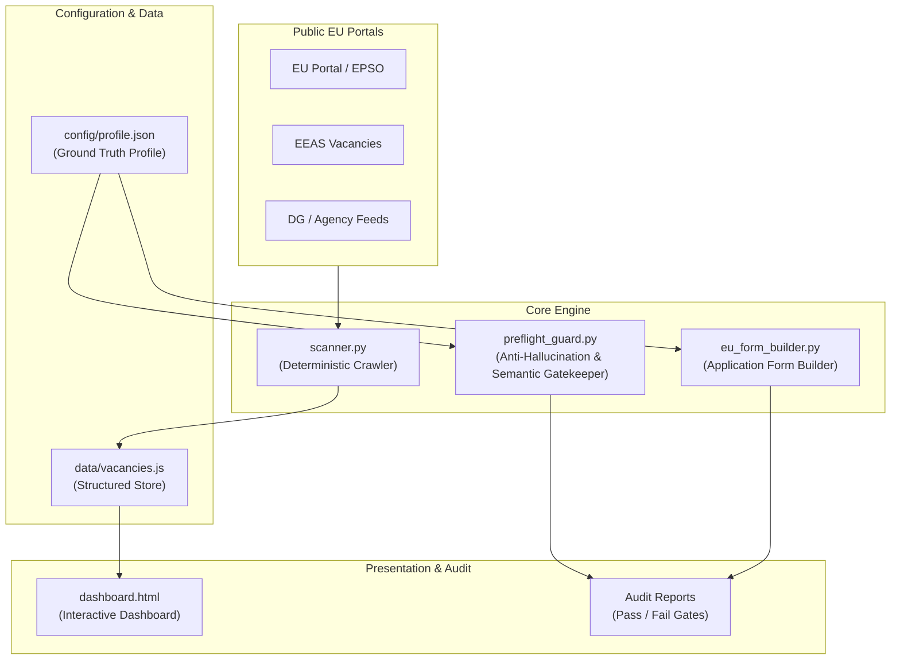

# EPSO Opportunity Scanner & Compliance Engine

> A deterministic scanning, compliance auditing, and application automation engine for European Union contract agent vacancies (FG III & FG IV).

[](LICENSE)
[](#requirements)

---

## 📌 Overview

**EPSO Opportunity Scanner** is an open-source developer toolkit designed to automate the discovery, eligibility screening, and compliance verification of European Public Service job openings across EU institutions, directorates-general, and executive agencies.

Unlike generic job scrapers, this system couples **deterministic multi-source web crawlers** with an **anti-hallucination pre-flight gatekeeper** that enforces strict semantic field isolation and exact profile validation against a candidate ground-truth specification.

---

## 🛠️ Key Capabilities

- **Deterministic Web Scraper (`scanner.py`)**: Crawls 25+ EU portals (EEAS, DG REGIO, Eurostat, CERT-EU, ENISA, etc.) without relying on nondeterministic LLM calls for information retrieval.
- **Pre-Flight Semantic Gatekeeper (`preflight_guard.py`)**:
  - Eliminates prompt/model hallucination before document compilation.
  - Automatically screens for hard blockers (mandatory pre-existing Personnel Security Clearances, required non-profile languages, experience thresholds).
  - Enforces zero field pollution (e.g., verifying language sections contain *strictly* language competencies, not administrative or metadata tokens).
- **Canonical PDF Form Engine (`eu_form_builder.py`)**: Compiles official multi-page European Commission application forms and overlays candidate credentials with exact pixel positioning.
- **Interactive Offline Dashboard (`dashboard.html`)**: Client-side visual workspace to filter vacancies by institution, function group, estimated net compensation, and profile fit.

---

## 📐 System Architecture



---

## 🚀 Getting Started

### 1. Prerequisites

- Python 3.10+ (macOS, Linux, or Windows with WSL2 / PowerShell)
- Git

### 2. Installation

Clone the repository and set up a virtual environment:

```bash
git clone https://github.com/your-username/epso-opportunity-scanner.git
cd epso-opportunity-scanner

python -m venv venv
# On Windows:
.\venv\Scripts\activate
# On Linux/macOS:
source venv/bin/activate

pip install -r requirements.txt
```

### 3. Profile Setup

Copy the sample configuration file and tailor it with your qualifications:

```bash
cp config/profile.json.example config/profile.json
```

`config/profile.json` is automatically ignored by Git to keep your personal data strictly private and offline.

---

## 💻 CLI Usage

### Running the Vacancy Scanner

```bash
python scanner.py
```
This fetches active openings, computes compensation coefficients, checks profile fit, and updates `data/vacancies.js`.

### Opening the Dashboard

Double-click `dashboard.html` in your browser to inspect matches, deadlines, and grade breakdowns.

### Screening a Notice for Blockers

```bash
python preflight_guard.py screen-notice path/to/vacancy_notice.pdf
```

### Auditing an Application Package

```bash
python preflight_guard.py audit path/to/generated_package.pdf
```

### Running the Test Suite

```bash
python -m unittest discover -s tests
```

---

## 🗺️ Roadmap & Next Steps

This project is actively maintained. Planned engineering milestones include:

- [ ] **Database Migration:** Replace flat `.js` data serialization with SQLite / DuckDB storage via SQLAlchemy.
- [ ] **Modern Web Interface:** Migrate the standalone HTML dashboard to a FastAPI backend + Next.js / Tailwind UI.
- [ ] **Async Crawling:** Upgrade the `requests` scraper to an asynchronous `httpx` / `playwright` engine for high concurrency.
- [ ] **Notification Dispatcher:** Automated email / webhook alerts when high-match FG IV roles appear.
- [ ] **Comprehensive Test Coverage:** Add automated integration tests and mock network responses using `pytest` and `responses`.

---

## 📄 License

This project is distributed under the [MIT License](LICENSE).
